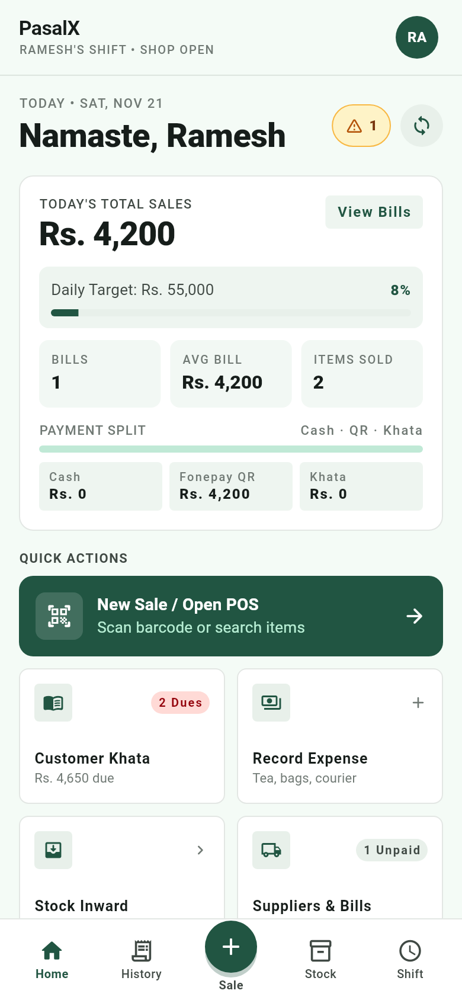
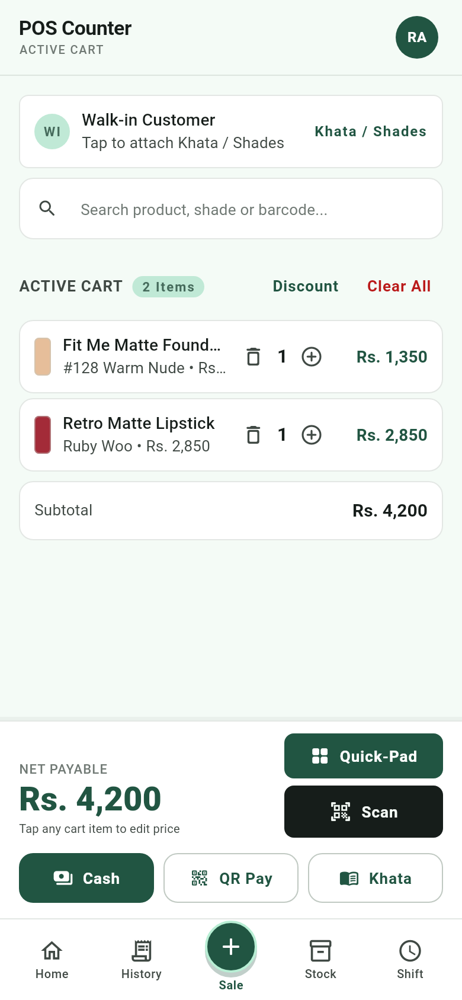
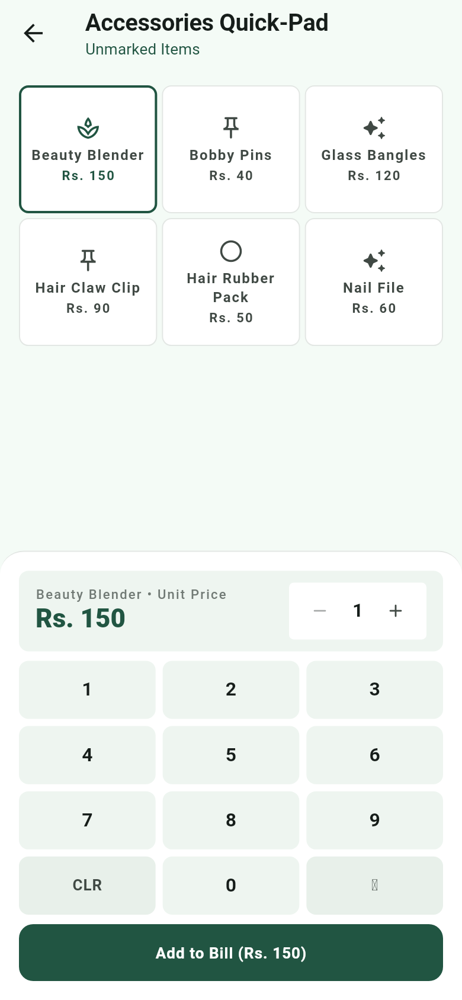
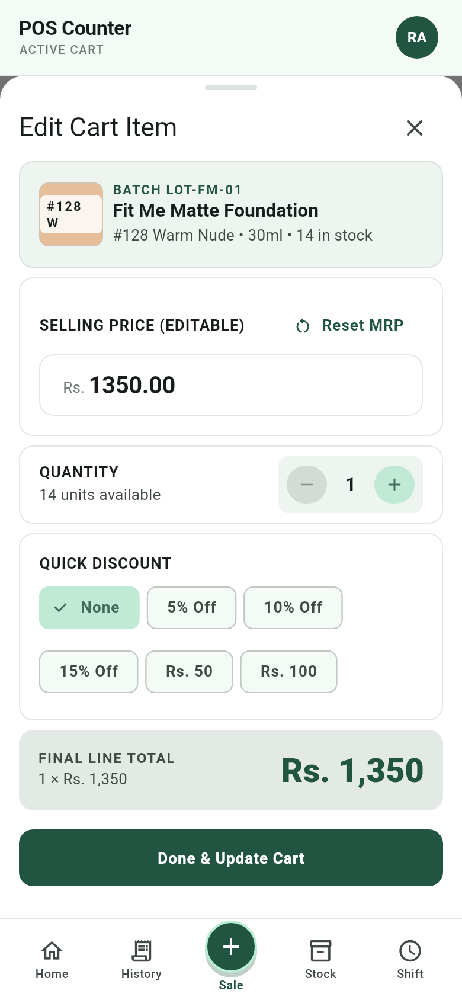
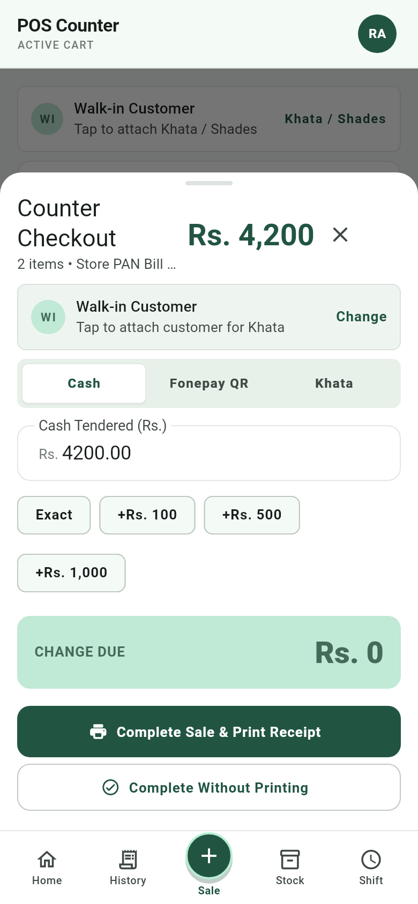
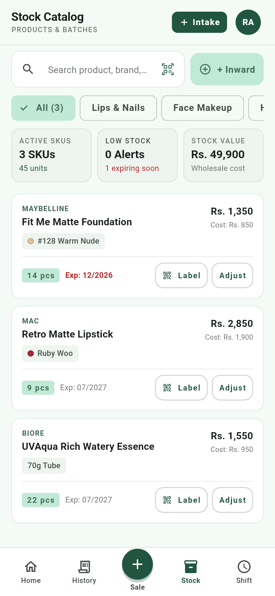
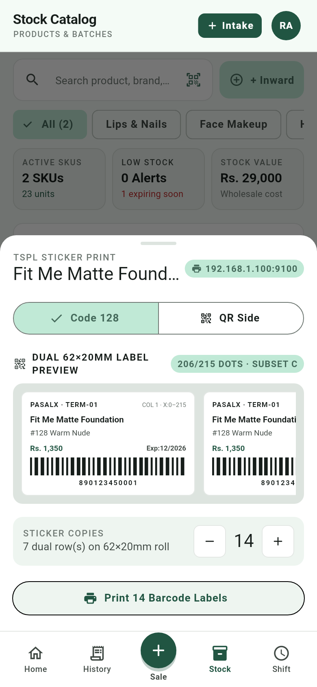
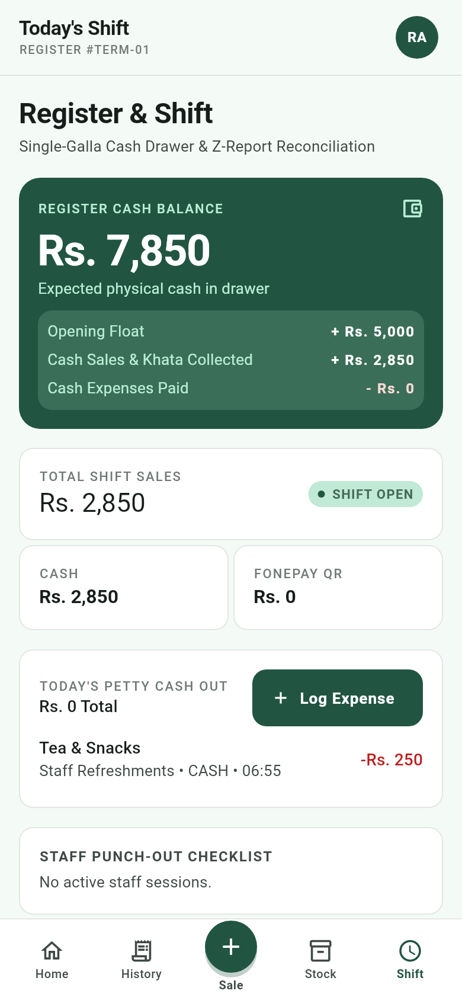
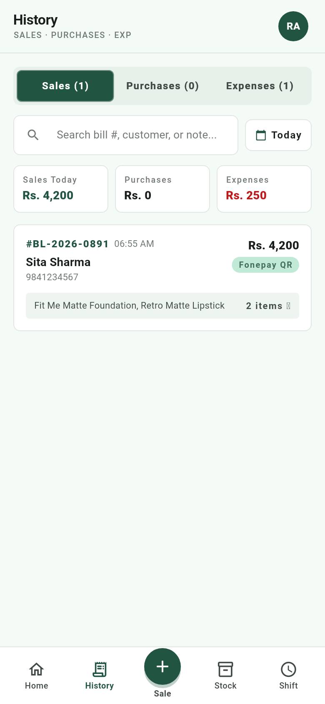
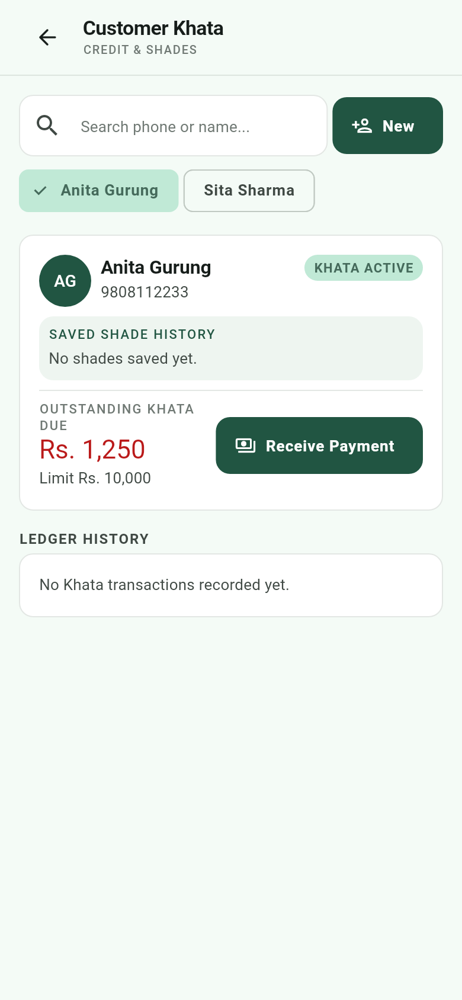

# PasalX

[](https://github.com/sann2sh/pasal/actions/workflows/ci.yml)
[](LICENSE)

Offline-first mobile POS, inventory, and shop accounting suite built for retail stores. Runs locally on Android/Linux with an encrypted SQLite vault and synchronizes idempotently with a multi-tenant Go + PostgreSQL backend.

---

## Screenshots

| Dashboard | POS Terminal | Quick-Pad (Unmarked) | Per-Item Discount | Cash Checkout |
| :---: | :---: | :---: | :---: | :---: |
|  |  |  |  |  |

| Inventory Catalog | TSPL Label Printing | Register & Shift | Sales & Expenses | Customer Khata |
| :---: | :---: | :---: | :---: | :---: |
|  |  |  |  |  |

---

## Key Features

- **Offline-First Counter & Encrypted Vault:** Local Drift + SQLCipher AES-256 database with volatile RAM key holding, 12-hour HKDF-derived DEK leases, offline PIN unlock, and remote device kill-switch wipe.
- **3-Tier Inventory & FEFO:** `Product → Variant → Batch` hierarchy with variant attributes (size, color, volume), FEFO expiry warnings, expired-batch hard blocks, and 3×3 Quick-Pad for unmarked items.
- **POS & Khata Credit:** Camera (`mobile_scanner`) and HID Bluetooth laser scanner support, 4-tier discount negotiation, split tender (Cash, Static Fonepay QR, Card, Khata), and customer credit/purchase profiles.
- **Thermal Printing (TCP 9100):** Direct `dart:io` socket driver for Xlab 365T dual-mode printers supporting 80mm ESC/POS PAN-only receipts and 62×20mm dual-column TSPL Code 128 barcode labels.
- **Multi-Tenant Sync Engine:** Idempotent delta push (`ON CONFLICT DO NOTHING`), atomic stock deltas, microsecond snapshot pull with role-based field masking (`OWNER` / `MANAGER` / `STAFF`), real-time SSE change notifications, and PostgreSQL Row-Level Security (RLS).
- **Single-Galla Register & Z-Report:** Multi-phone shift punch-in, petty cash expense tracking, supplier ledger & invoice settlements, force punch-out, and end-of-day Z-Report with bank drop & float rollover.

---

## Tech Stack

| Layer | Technology |
| :--- | :--- |
| **Mobile** | Flutter, Riverpod, GoRouter, Drift + SQLCipher, `mobile_scanner` |
| **Backend** | Go (`net/http`), `pgx/v5`, `golang-migrate`, Argon2id + HKDF-SHA256 |
| **Database** | PostgreSQL 16 with Row-Level Security (`ENABLE ROW LEVEL SECURITY`) |
| **Infra** | Caddy (HTTPS + SSE), systemd, automated GPG-encrypted `pg_dump` backups |

---

## Architecture & Security

- **Two-Key Envelope Encryption:** The local SQLCipher database is encrypted with a 256-bit Data Encryption Key (DEK) held only in RAM—never persisted in plaintext. On login, the Go API issues a 12-hour HKDF-SHA256 Key Encryption Key (KEK) lease that unwraps a 64-byte AES-256-GCM envelope to release the DEK; on expiry or revocation, RAM is zeroed and the database locks.
- **Idempotent Sync & Real-Time SSE:** Offline mutations are pushed with `ON CONFLICT DO NOTHING` idempotency so retries never duplicate sales, while Server-Sent Events (`/api/sync/events`) notify connected store devices of updates in real time.
- **Multi-Tenant Isolation:** Store boundaries are enforced at the database layer via PostgreSQL Row-Level Security (`ENABLE ROW LEVEL SECURITY`), paired with role-based access (`OWNER` / `MANAGER` / `STAFF`) and field masking.

---

## Production Deployment

Production configs live in [`deploy/`](deploy/) for running on a Google Cloud VM: Caddy terminates HTTPS with unbuffered SSE proxying (`flush_interval -1`), `systemd` runs the hardened `pasalx-api` service, and a `systemd` timer triggers automated GPG-encrypted `pg_dump` backups.

---

## Repository Structure

```text
.
├── server/                 # Go API server, auth, sync engine, admin CLI & SQL migrations
│   ├── cmd/api/            # HTTP server entrypoint
│   ├── cmd/pasalx-admin/   # Migration & store administration CLI
│   ├── internal/           # auth, db, mail, sync packages
│   └── migrations/         # Embedded versioned PostgreSQL migrations
├── mobile/                 # Flutter client (Android & Linux)
│   ├── lib/core/           # Theme, router, Drift/SQLCipher DB, printer driver, sync worker
│   ├── lib/features/       # auth, home, pos, inventory, history, register, suppliers, settings
│   └── test/               # Unit, widget, printer, security & E2E tests
├── deploy/                 # Caddyfile, systemd units, backup script
├── scripts/                # Deployment & env push helpers
├── designs/                # Screen mockups & interactive HTML prototype
└── docker-compose.yml      # Local PostgreSQL 16 dev container
```

---

## Local Development

### 1. Start PostgreSQL

```bash
docker compose up -d
```

### 2. Configure & Run the Go Server

```bash
cd server
cp .env.example .env

# Generate a 32-byte master key and set PASALX_MASTER_KEY in .env
go run ./cmd/pasalx-admin gen-master-key

# Run database migrations
go run ./cmd/pasalx-admin migrate up

# Start the API server (listens on :8080)
go run ./cmd/api
```

### 3. Run the Flutter App

```bash
cd mobile
flutter pub get
flutter run --dart-define=PASALX_API_URL=http://10.0.2.2:8080
```

---

## Running Tests

### Go Backend

```bash
cd server
go vet ./...
go test -count=1 -race ./...
```

### Flutter Mobile

```bash
cd mobile
flutter analyze --no-pub
flutter test --no-pub
```

---

## Roadmap

- **Cleaner UI:** Ongoing polish and layout refinements driven by live shop testing.
- **Batch Product Updates:** Bulk price, expiry, and stock adjustments across multiple SKUs and batches.
- **Data Export:** CSV/PDF exports for sales, inventory, khata ledgers, and Z-reports.
- **Web Admin & Analytics:** Browser-based owner dashboard for multi-day trends, margins, and store oversight.
- **AI Voice & MCP Assistant:** Conversational voice queries and inventory actions via MCP (e.g., *"How much did we sell today?"* or *"Add this new product"*).

---

## License

[MIT](LICENSE)
